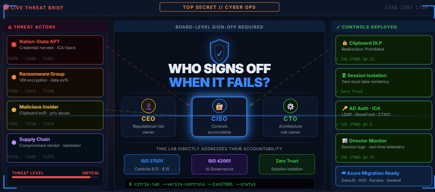
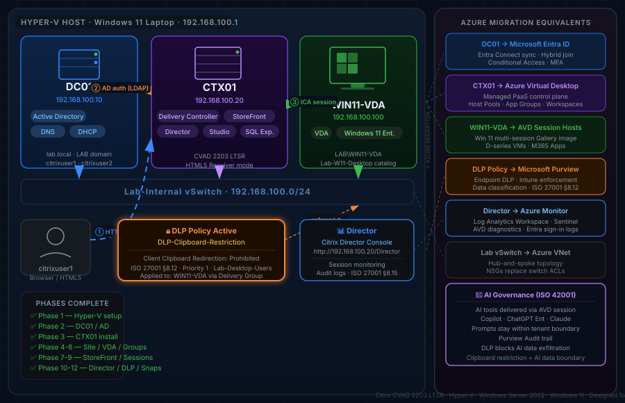

# Citrix Virtual Apps & Desktops (CVAD) Home Lab: Architecture and Build Guide

> **A hands-on Citrix CVAD 7 2203 LTSR home lab built on Hyper-V — documenting every phase from bare-metal setup to security policy enforcement, compliance alignment, and a cloud migration design mapping the full deployment to Microsoft Azure Virtual Desktop.**

---



> *Nation-state actors don't wait for the board to sign off. This lab demonstrates how a security-first Citrix architecture — with DLP enforcement, session monitoring, and ISO 27001 alignment — addresses the threats that keep your CEO, CISO, and CTO up at night.*

---

## 🏗️ Lab Architecture

| Component | VM Name | IP Address | Role |
|---|---|---|---|
| Domain Controller | DC01 | 192.168.100.10 | Active Directory, DNS, DHCP |
| Citrix Delivery Controller | CTX01 | 192.168.100.20 | Delivery Controller, StoreFront, Director, Studio |
| Virtual Desktop Agent | WIN11-VDA | 192.168.100.100 | Windows 11 VDA (end-user desktop) |
| Host Machine | — | 192.168.100.1 | Hyper-V hypervisor (laptop) |

**Domain:** `lab.local` | **NetBIOS:** `LAB`

---

## 🗺️ Architecture Diagram

The diagram below shows the full lab topology — three VMs on a Hyper-V internal vSwitch, the end-to-end session delivery flow (HTTP logon → AD auth → ICA session), DLP policy enforcement, and the cloud migration mapping to Azure equivalents.



> **Session flow:** `citrixuser1` (browser) → StoreFront (CTX01) → AD authentication (DC01 / LDAP) → ICA session (WIN11-VDA) — clipboard DLP policy enforced throughout via `DLP-Clipboard-Restriction`.  
> **Right panel:** Every on-premises component mapped to its Azure equivalent — Entra ID, AVD, Purview DLP, Azure Monitor / Sentinel, and an ISO 42001 AI governance design.

---

## 🎯 Project Objectives

This home lab replicates the architecture and decision-making of a real enterprise Citrix CVAD deployment — built from scratch on a single laptop using Hyper-V. It covers the full stack: identity, virtualisation, session delivery, security policy, monitoring, and a cloud migration design.

**Business value this lab demonstrates:**
Organisations running Citrix on-premises face rising infrastructure costs, compliance pressure, and a new challenge: governing employee access to AI tools. This lab shows how Citrix CVAD — and its Azure equivalent, AVD — solves all three: reducing endpoint sprawl, enforcing data controls aligned to ISO 27001, and providing a secure boundary for AI tool delivery auditable under ISO 42001. The same architecture pattern is used by financial services firms, law firms, and NHS trusts to protect sensitive data while enabling flexible working.

**Scope covered:**
- Secure virtual desktop delivery with Active Directory authentication and session management
- Data Loss Prevention (DLP) policy enforcement at the Citrix policy layer
- Centralised monitoring and helpdesk capability via Citrix Director
- Compliance alignment with **ISO 27001 Control 8.12** (Data Leakage Prevention)
- AI tool governance design aligned to **ISO 42001**
- Cloud migration design: mapping every on-prem component to its **Microsoft Azure** equivalent

---

## ☁️ Azure Migration Design

> **Note:** This section is a migration design and architecture mapping — not a deployed Azure environment. It demonstrates how the on-premises Citrix lab maps to Azure equivalents and the design decisions an architect would make during that migration. Hands-on AVD deployment is a planned next phase.

The table below maps every on-premises Citrix component to its Azure equivalent — the path an enterprise would take to lift this deployment into Azure.

| On-Prem Component | Azure Equivalent | Notes |
|---|---|---|
| Hyper-V Hypervisor | Azure Virtual Machines (IaaS) | Host VMs in Azure compute — B-series for dev/test, D-series for production |
| DC01 — Active Directory | Azure Entra ID + AD DS on Azure VM | Hybrid identity: sync on-prem AD to Entra ID via Entra Connect |
| CTX01 — Delivery Controller | Azure Virtual Desktop (AVD) Control Plane | AVD is a fully managed PaaS — no Delivery Controller VM needed in Azure |
| CTX01 — StoreFront | AVD Web Client / Microsoft Workspace | Native browser-based access — no StoreFront infrastructure required |
| CTX01 — Citrix Studio | Azure Portal + AVD Host Pool configuration | Host pools, application groups and workspaces replace Studio |
| WIN11-VDA — Session Host | AVD Session Hosts (Windows 11 multi-session) | Azure Gallery image: Windows 11 Enterprise multi-session + M365 Apps |
| Citrix Director | Azure Monitor + Log Analytics Workspace | Session telemetry, diagnostics and alerts via Azure Monitor |
| DLP Clipboard Policy | Microsoft Purview DLP + Intune | Endpoint DLP policies enforced via Intune, data classification via Purview |
| Hyper-V Checkpoints | Azure VM Snapshots + Recovery Services Vault | Automated backup policies and point-in-time restore |
| Lab-Internal vSwitch | Azure Virtual Network (VNet) + NSG | Subnet isolation, NSGs replace physical switch ACLs |
| SQL Server Express | Azure SQL Managed Instance / SQL Database | PaaS database — no SQL Server VM maintenance |

**Architecture decisions for Azure migration:**

- **Identity:** Hybrid Entra ID join — on-prem AD synced to Entra ID via Entra Connect. Conditional Access policies enforce MFA on all AVD logons
- **Networking:** Hub-and-spoke VNet topology. AVD session hosts in a dedicated spoke VNet, peered to hub containing AD DS and shared services
- **Security:** Microsoft Defender for Cloud enabled across all resources. Purview DLP replaces Citrix clipboard policy with richer classification-aware controls
- **Monitoring:** Log Analytics Workspace ingests AVD diagnostics, Entra ID sign-in logs, and Defender alerts — feeding into a Microsoft Sentinel SIEM
- **AI Governance (ISO 42001):** AI tools (Copilot for M365, ChatGPT Enterprise, Claude) delivered through AVD session hosts — prompts and outputs stay within the Azure tenant boundary, auditable via Purview Audit

---

## 🤖 AI & Modern Relevance

Citrix CVAD is increasingly positioned as **secure AI delivery infrastructure**:

- **Secure AI Workstation Delivery** — AI tools (Copilot, ChatGPT Enterprise, Claude, internal LLMs) can be delivered as published applications through Citrix, keeping prompts and outputs inside a controlled environment rather than on employee laptops
- **Data Boundary Enforcement** — DLP policies like the one built in this lab prevent AI-generated sensitive content from being copy-pasted out of virtual sessions to unmanaged devices
- **Centralised Monitoring** — Director gives visibility into who accessed AI tools, session duration, and endpoint details — feeding into SIEM/audit pipelines
- **Zero Trust for AI** — Combining Citrix with identity providers (Entra ID, Duo) ensures AI access is gated behind MFA and conditional access, not just VPN

**Risk Consideration:** AI-assisted productivity tools introduced into a Citrix environment without DLP controls create a data exfiltration risk — users could paste sensitive company data into public AI services. The clipboard restriction policy in this lab directly mitigates that risk.

---

## 📋 Build Phases

### ✅ Phase 1 — Hyper-V Host Preparation
- Enabled Hyper-V role on Windows 11 host laptop
- Created internal virtual switch (`Lab-Internal`) — isolated network for all lab VMs
- Configured host IP: `192.168.100.1/24`

---

### ✅ Phase 2 — Domain Controller (DC01)
- Deployed Windows Server 2022 VM (DC01)
- Installed AD DS, DNS, DHCP roles
- Promoted to domain controller: `lab.local`
- Created lab users: `citrixuser1`, `citrixuser2`
- Created security group: `Citrix-Desktop-Users`

---

### ✅ Phase 3 — CTX01 Component Installation
- Deployed Windows Server 2022 VM (CTX01)
- Joined domain: `LAB\CTX01`
- Mounted CVAD 2203 LTSR ISO
- Installed all Citrix components onto CTX01: Delivery Controller, Studio, StoreFront, Director
> Configuration of each component follows in Phases 7–10

---

### ✅ Phase 4 — SQL Database & Site Configuration
- Installed Microsoft SQL Server (Express) on CTX01
- Created Citrix Site database: `CitrixSite`
- Configured Site using Citrix Studio wizard
- Verified database connectivity and site health

---

### ✅ Phase 5 — Windows 11 VDA (WIN11-VDA)
- Deployed Windows 11 VM (WIN11-VDA)
- Joined domain: `LAB\WIN11-VDA`
- Installed Citrix Virtual Delivery Agent (VDA) — Desktop OS
- VDA registered successfully with CTX01 Delivery Controller

---

### ✅ Phase 6 — Machine Catalog & Delivery Group
- Created Machine Catalog: **`Lab-W11-Desktop`**
  - Type: Static (single user), existing image
  - Added WIN11-VDA to catalog
- Created Delivery Group: **`Lab-Desktop-Users`**
  - Assigned Machine Catalog
  - Added `LAB\Citrix-Desktop-Users` as allowed users (AD security group created in Phase 2)
  - Desktop entitlement: Windows 11 desktop
  > Note: `Citrix-Desktop-Users` is the Active Directory group controlling identity; `Lab-Desktop-Users` is the Citrix Delivery Group controlling entitlement — two separate objects by design.

---

### ✅ Phase 7 — StoreFront Configuration

**Challenge Encountered:** Initial store creation accidentally enabled "Allow only unauthenticated users" — resulting in a blank store with no desktops visible.

**Fix:** Deleted the store, recreated it correctly with authentication enabled.

**StoreFront Setup:**
- Store Name: `LabStore`
- Virtual Path: `/Citrix/LabStore`
- Delivery Controller: `CTX01.lab.local`
- Authentication Methods: Username & Password (Active Directory)
- Web Receiver: Enabled with **"Always use Receiver for HTML5"** setting

> **Note on HTML5 mode:** Citrix Workspace App 26.x blocks HTTP (non-SSL) store connections by default. Switching to HTML5 Receiver bypasses the native app entirely — users authenticate and launch desktops through the browser without needing the Workspace App installed. This is ideal for lab environments without SSL certificates.

---

### ✅ Phase 8 — Citrix Studio Installation & Verification

> 📹 **Video walkthrough available** — see Phase 3 in the Video Walkthroughs section below.

**What was verified in Studio:**
- Site database: Connected and healthy
- Delivery Controller: Online and registered
- Machine Catalog: `Lab-W11-Desktop` — 1 machine, 0 unregistered
- Delivery Group: `Lab-Desktop-Users` — Desktop available
- VDA Registration: WIN11-VDA registered (Green)

---

### ✅ Phase 9 — End-to-End Session Test

> 📹 **Video walkthrough available** — see Phase 9 in the Video Walkthroughs section below.

**Test scenario:** Log in as `citrixuser1` via browser, launch Windows 11 virtual desktop, verify session is active.

**Steps performed:**
1. Opened StoreFront URL: `http://192.168.100.20/Citrix/LabStoreWeb`
2. Logged in as `LAB\citrixuser1`
3. Desktop enumeration: Windows 11 desktop appeared in store
4. Launched desktop — Citrix HTML5 Receiver opened the session
5. Session confirmed active in Citrix Director

**Result: ✅ End-to-end desktop delivery working**

**Troubleshooting encountered and resolved:**
- StoreFront store initially created with anonymous access enabled (unauthenticated) → deleted and recreated with AD authentication → desktops became visible
- Citrix Workspace App 26.x blocked HTTP store connection → switched StoreFront to HTML5 Receiver mode → browser-based login worked without Workspace App
- Desktop session failed to launch → WIN11-VDA VM was powered off → powered on → session launched successfully

---

### ✅ Phase 10 — Citrix Director Installation & Configuration

Citrix Director is the web-based monitoring and helpdesk console for CVAD.

**Installation:**
- Mounted CVAD ISO on CTX01
- Ran autoplay → "Extend Deployment" → Selected **Director**
- Accepted prerequisite installation (IIS, ASP.NET, .NET Framework)
- Completed installation — IIS site created at `/Director`

**Restart required:** CTX01 rebooted after Director installation.

**Sign-in:** `http://192.168.100.20/Director`
- Credentials: `LAB\Administrator` (domain admin)
- Site connected automatically (same server as Delivery Controller)

**Director capabilities verified:**
- Active session monitoring (Session Details, Client IP, Protocol)
- User activity history
- Machine status dashboard
- Session shadowing (requires Windows Remote Assistance on VDA)
- Alert policies and notifications

---

### ✅ Phase 11 — DLP Security Policy: Clipboard Restriction

> 📹 **Video walkthrough available** — see Phase 11 in the Video Walkthroughs section below.

**Policy Name:** `DLP-Clipboard-Restriction`  
**Compliance Alignment:** ISO 27001 Control 8.12 — Data Leakage Prevention  
**AI Relevance:** Prevents users from copy-pasting sensitive data to/from virtual sessions — critical when AI tools are delivered through Citrix

**Policy Configuration (Citrix Studio → Policies):**

| Setting | Value |
|---|---|
| Policy Name | DLP-Clipboard-Restriction |
| Description | Restricts clipboard transfer between virtual session and client device — ISO 27001 Control 8.12 |
| Client Clipboard Redirection | Prohibited |
| Assignment | Delivery Group: Lab-Desktop-Users |
| Priority | 1 (highest) |

**What this policy does:**
- Blocks copy/paste between the virtual desktop and the user's local device
- Data typed or created inside the Citrix session cannot be exfiltrated via clipboard to an unmanaged endpoint
- Works bidirectionally — also blocks pasting local content into the virtual session (e.g. pasting credentials from a local password manager into a server session)

---

### ✅ Phase 12 — Hyper-V Checkpoints (Lab Snapshots)

Checkpoints taken after full lab completion to preserve working state:

```powershell
# Run as Administrator on Hyper-V host
Checkpoint-VM -Name CTX01 -SnapshotName "StoreFront + Director + DLP Policy configured"
Checkpoint-VM -Name DC01  -SnapshotName "Lab complete - DC01 fully configured"
Checkpoint-VM -Name WIN11-VDA -SnapshotName "Lab complete - VDA registered and working"
```

---

## ⚠️ Lab Scope & Known Limitations

This is a home lab, not a production deployment. The following gaps are acknowledged and intentional given the single-laptop, isolated environment:

| Limitation | Production Equivalent | Planned |
|---|---|---|
| No SSL/TLS — HTTP only | SSL certificate + HTTPS on all services | Phase 13 (with NetScaler) |
| No Citrix Gateway / NetScaler | NetScaler ADC for external access and MFA | Phase 13 |
| No MFA | Duo, Entra ID SAML, or RADIUS MFA at StoreFront | Phase 13 |
| SQL Server Express | Full SQL Server with AlwaysOn AG | Out of scope for lab |
| Single Delivery Controller | Minimum two for HA in production | Out of scope for lab |
| Single VDA | Machine catalog with multiple session hosts | Future phase |
| No logging pipeline | Windows Event forwarding to SIEM | Future phase |
| Shared Administrator account | Privileged Access Workstation (PAW) model | Out of scope for lab |
| No MCS / PVS | Machine Creation Services for image-based VDA provisioning | Future phase |

> Acknowledging these gaps is part of good architecture practice. Each limitation has a documented production equivalent and a clear path forward.

---

## 🔐 Security Posture Summary

| Control | Implementation | Standard |
|---|---|---|
| Authentication | Active Directory username/password | ISO 27001 §8.5 (MFA planned — Phase 13) |
| Session Isolation | Virtual desktop — no local data | Zero Trust principle |
| Clipboard DLP | Citrix Policy — Client Clipboard Redirection: Prohibited | ISO 27001 §8.12 |
| Audit Trail | Citrix Director — session logs | ISO 27001 §8.15 |
| Snapshot Recovery | Hyper-V checkpoints at each major phase | Business Continuity |

---

## 🛠️ Tech Stack

- **Hypervisor:** Microsoft Hyper-V (Windows 11 host)
- **Guest OS:** Windows Server 2022 (DC01, CTX01), Windows 11 (WIN11-VDA)
- **Citrix Version:** CVAD 7 2203 LTSR
- **Components:** Delivery Controller, Studio, StoreFront, Director, VDA
- **Database:** Microsoft SQL Server Express
- **Identity:** Active Directory (lab.local)
- **Networking:** Internal Hyper-V switch — 192.168.100.0/24

---

## 📁 Repository Structure

```
citrix-home-lab/
├── README.md                        ← This file (full build documentation)
├── citrix-lab-architecture.svg      ← Architecture diagram (inline in README)
└── threat-briefing.png              ← Opening threat narrative image
```

> Screenshots and video evidence are being added progressively. The README is the primary documentation artefact.

---

## 📹 Video Walkthroughs

Screen recordings of each major phase — hosted directly on GitHub.

| Phase | Description | Status |
|---|---|---|
| Phase 3 | Citrix Studio Installation | [▶ Watch](https://github.com/user-attachments/assets/ca77dfda-7692-4404-af22-60f000d09360) |
| Phase 7 | StoreFront Configuration  | [▶ Watch](https://github.com/user-attachments/assets/ca77dfda-7692-4404-af22-60f000d09360) |
| Phase 9 | End-to-End Session Test | [▶ Watch](https://github.com/user-attachments/assets/9f44a70f-1ff9-45fd-9ff8-4987cf3b6942) |
| Phase 10 | Setting Up Citrix Director | 🔜 Link coming |
| Phase 11 | DLP Clipboard Restriction Policy | ✅ Available |

> 🎬 Videos for Phase 9 and Phase 11 are ready — links will be added once uploaded to GitHub. Remaining recordings being added progressively.

---

## 👤 Author

**Joshua Ajala**

**Certifications:**
- 🏆 Microsoft Certified: Azure Solutions Architect Expert (AZ-305)
- 🔐 CISM — Certified Information Security Manager (ISACA)
- 📋 ISO 27001 Lead Implementer
- 🤖 ISO 42001 Lead Implementer (AI Management Systems)
- 🏅 Computing Top 100 IT Leader 2026

**Background:**  
Cybersecurity and AI governance professional with hands-on expertise across Citrix virtual desktop infrastructure, Microsoft Azure architecture, and enterprise security frameworks. This lab covers the full CVAD stack end-to-end — security policy enforcement, compliance alignment to ISO 27001 and ISO 42001, and a migration design mapping every component to its Azure equivalent.

**Areas of expertise:** Citrix CVAD · Azure Virtual Desktop (AVD) · Microsoft Entra ID · ISO 27001 · ISO 42001 · AI Governance · Data Loss Prevention · Zero Trust Architecture

🔗 [LinkedIn](https://www.linkedin.com/in/olufemi-joshua-ajala/)

---

*Lab built on: Hyper-V | Citrix CVAD 2203 LTSR | Windows Server 2022 | Windows 11 | Designed for Azure migration*
